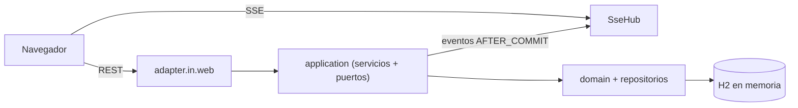

# airplane_reservs

Sistema de reservas de vuelos en tiempo real (kata). Permite buscar vuelos, bloquear un asiento de forma temporal, confirmar la reserva y ver la ocupación en vivo, sin sobre-reservas.

Proyecto personal para aprender **Spring Boot** y estructuras de arquitectura.

## Requisitos

- Java 17 o superior (`java -version`). Maven se descarga solo mediante el wrapper (`mvnw`).
- Node 20 o superior (`node -v`), solo para construir el frontend React.

## Cómo ejecutar todo

```bash
# 1. Construir el frontend (React + Vite) una vez
cd frontend
npm install
npm run build

# 2. Arrancar el backend, que también sirve el frontend
cd ../backend
./mvnw spring-boot:run
```

Abre <http://localhost:8080>. **Un solo proceso** sirve la API (`/api/...`), el stream en tiempo real (`/api/stream`) y la interfaz (`frontend/dist`).

> Ejecuta el backend desde `backend/`: el frontend se busca en `../frontend/dist`. Si construyes el frontend con el backend ya arrancado, reinicia el backend.

**Para desarrollar el frontend** con recarga en caliente, usa dos terminales: `./mvnw spring-boot:run` en `backend/` y `npm run dev` en `frontend/`, y abre <http://localhost:5173>. Detalles en [frontend/README.md](frontend/README.md).

Para probar la expiración rápido, con bloqueos de 20 segundos:

```bash
./mvnw spring-boot:run -Dspring-boot.run.arguments="--reservations.hold-duration=20s"
```

Más opciones (jar, puerto, propiedades, problemas frecuentes): [backend/README.md](backend/README.md).

## Probar el tiempo real (2 minutos)

1. Abre <http://localhost:8080> en **dos pestañas** (cada pestaña es un cliente distinto).
2. En ambas, abre el mismo vuelo.
3. En la pestaña A elige un asiento: en la B se pone amarillo al instante y los contadores cambian.
4. En A confirma el pago: en B el asiento queda rojo (ocupado). Prueba también la tarjeta `4000000000000002` (pago rechazado).
5. Espera a que venza el bloqueo sin confirmar: el asiento vuelve a verde en ambas.
6. Abre la pestaña **Dashboard** para ver la ocupación de todos los vuelos en vivo.
7. En la pestaña **Admin** marca un vuelo como retrasado o cancelado: en la otra pestaña la lista cambia sin recargar, aparece un aviso y los asientos se deshabilitan.

## Arquitectura

Monolito modular con arquitectura hexagonal ligera. Tiempo real con Server-Sent Events. La concurrencia la resuelve la base de datos con un `UPDATE` condicional atómico.



Diagramas completos y manejo de concurrencia: [docs/architecture.md](docs/architecture.md).

## Documentación

```
README.md                   Este archivo: qué es y cómo ejecutarlo
backend/README.md           Backend: cómo correrlo y todas las peticiones con ejemplos
frontend/README.md          Frontend React: cómo correrlo y estructura
docs/
  architecture.md           Diseño, diagramas y concurrencia (requerido por el kata)
  ia.md                     Uso de IA (requerido por el kata)
  shared/                   Material de referencia compartido
    openapi.yaml            Contrato de la API (Swagger/OpenAPI)
    how-it-works.md         Datos, estado de asientos y pago
    decisions.md            Decisiones, alternativas y cuándo cambiarlas
    spring-concepts.md      Dónde ver cada concepto de Spring + ejercicios
frontend/
  README.md                 Frontend: cómo correrlo y cómo fluye el tiempo real
  src/                      React + Vite + TypeScript
```

- ¿Quieres **usar la API**? Empieza por [backend/README.md](backend/README.md). Para importarla en Swagger Editor, Postman o Insomnia usa [docs/shared/openapi.yaml](docs/shared/openapi.yaml).
- ¿Quieres **entender cómo funciona**? [docs/shared/how-it-works.md](docs/shared/how-it-works.md).
- ¿Quieres saber **por qué se hizo así**? [docs/shared/decisions.md](docs/shared/decisions.md).

## Limitaciones

Una sola instancia, sin autenticación, datos en memoria y sin pruebas automáticas todavía. Cada una tiene su camino de salida en [docs/shared/decisions.md](docs/shared/decisions.md).
