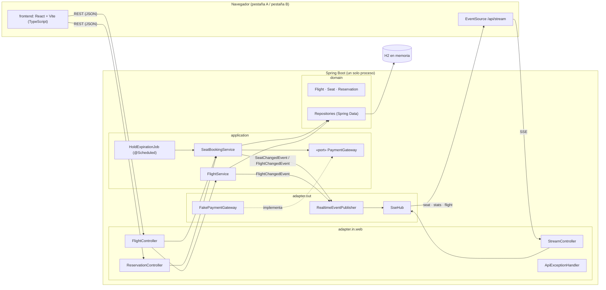
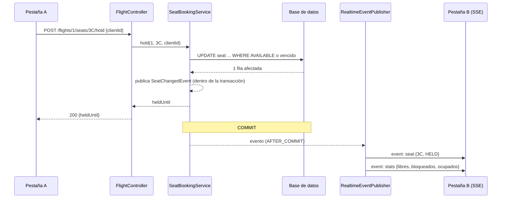
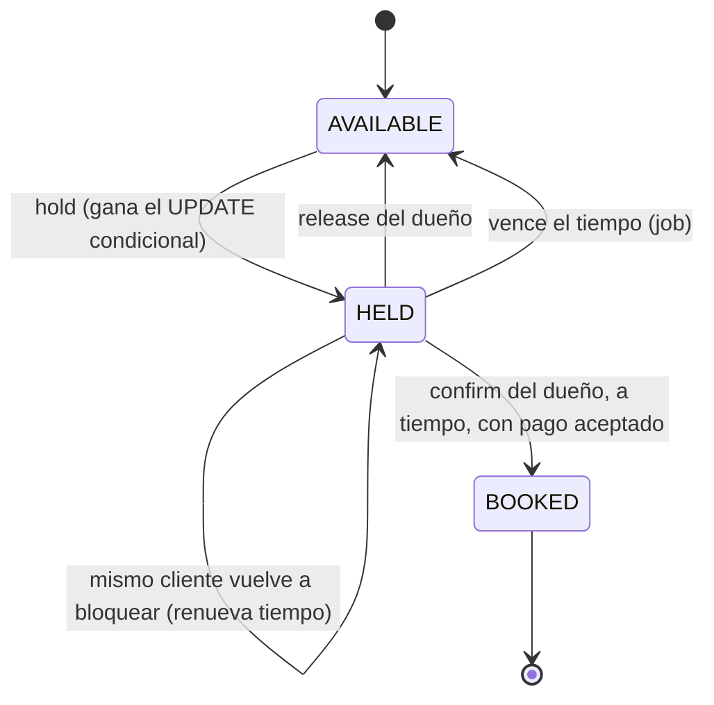

# Arquitectura

Resumen: **monolito modular, hexagonal ligera**, Spring Boot 4 + H2, tiempo real con Server-Sent Events.
Las alternativas descartadas y las señales para cambiarlas están en [decisions.md](shared/decisions.md).

## Diagrama de componentes

Regla de dependencias: `adapter` → `application` → `domain`. La aplicación define el puerto `PaymentGateway`; el adaptador lo implementa. `application` no importa nada de `adapter`.

## Flujo: bloquear un asiento y verlo en otra pestaña

Si el `UPDATE` afecta 0 filas, alguien llegó primero: respuesta `409 Conflict`.

## Ciclo de vida de un asiento

## Manejo de concurrencia y estado en tiempo real

- **Quién decide**: la base de datos, con un `UPDATE` condicional por transición. El resultado (1 o 0 filas) define el ganador. No hay "leer y luego escribir".
- **Prevención de doble reserva**: además, `UNIQUE (flight_id, seat_number)` en `Reservation`.
- **Vencimiento**: la condición `held_until < ahora` forma parte de la consulta, así que un bloqueo vencido se trata como libre aunque el job no haya corrido. El job (cada 1 s) solo se encarga de *avisar*.
- **Pago**: bloqueo confirmado, cobro y registro de la reserva comparten una transacción. Un pago rechazado revierte todo, y como los eventos salen `AFTER_COMMIT`, nadie ve cambios fantasma.
- **Tiempo real**: `SseHub` mantiene las conexiones abiertas y reenvía tres eventos: `seat` (cambio de un asiento), `stats` (conteos del vuelo, alimentan el dashboard) y `flight` (retrasado, cancelado, agotado).
- **Recuperación**: al reconectar, el navegador vuelve a pedir el estado completo, así que no depende de haber recibido todos los eventos.

Resultado verificado: 30 peticiones simultáneas sobre el mismo asiento dieron 1 × `200` y 29 × `409`.

## Cómo cubre cada historia de usuario

| Historia | Endpoint(s) | Evento en vivo |
|---|---|---|
| 1. Buscar y filtrar vuelos | `GET /api/flights?origin&destination&date` | `flight` (cambio de estado), `stats` (asientos libres) |
| 2. Bloqueo temporal de asiento | `POST` / `DELETE /api/flights/{id}/seats/{n}/hold` | `seat` con `HELD` y `heldUntil`; `AVAILABLE` al liberar o vencer |
| 3. Confirmar la reserva | `POST /api/flights/{id}/reservations` | `seat` con `BOOKED`; `flight` con `SOLD_OUT` al llenarse |
| 4. Dashboard de ocupación | `GET /api/flights/{id}/stats` | `stats` tras cada bloqueo, liberación, vencimiento o reserva |

## Decisiones clave (resumen)

| Tema | Elección | Detalle |
|---|---|---|
| Estilo | Monolito modular + hexagonal ligera | [§1](shared/decisions.md#1-estilo-de-arquitectura) |
| Concurrencia | `UPDATE` condicional atómico | [§3](shared/decisions.md#3-evitar-la-sobre-reserva-concurrencia) |
| Expiración | Condición en la consulta + job de aviso | [§4](shared/decisions.md#4-expiración-del-bloqueo-temporal) |
| Tiempo real | SSE, un stream global | [§5](shared/decisions.md#5-tiempo-real-sse) |
| Eventos | `@TransactionalEventListener(AFTER_COMMIT)` | [§6](shared/decisions.md#6-eventos-internos-y-momento-de-publicación) |
| Persistencia | H2 en memoria + JPA | [§7](shared/decisions.md#7-persistencia) |
| Frontend | React + Vite + TypeScript | [§13](shared/decisions.md#13-frontend) |

## Limitaciones conocidas

- Una sola instancia (las conexiones SSE viven en memoria). Ver [§8](shared/decisions.md#8-escalar-más-allá-de-una-instancia).
- Sin autenticación; el `clientId` es anónimo y el endpoint de cambio de estado del vuelo es abierto a propósito. Ver [§10](shared/decisions.md#10-identidad-del-cliente).
- Los datos se pierden al reiniciar (H2 en memoria).
- Sin pruebas automáticas. Ver [§15](shared/decisions.md#15-pruebas-pendiente).
